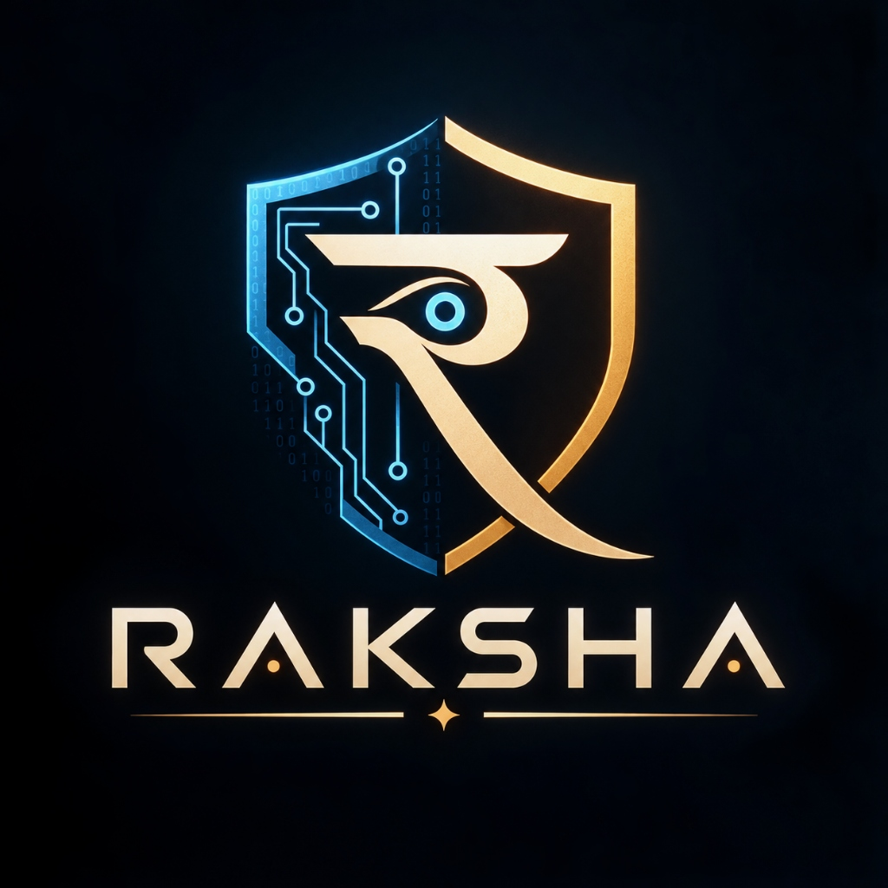

<div align="center">
  
  <h1>RAKSHA</h1>
  <h3>Adaptive Cyber Defense & Machine Learning Threat Analysis</h3>
  <p>An academic cybersecurity platform for orchestrating isolated VM attacks, collecting multi-source telemetry, and detecting multi-stage threats using Machine Learning.</p>
</div>

---

## 🛡️ Overview

**RAKSHA** is a lightweight cyber-defense framework designed to study how sequences of ordinary system events can be correlated to identify sophisticated, multi-stage cyber threats. 

Instead of relying solely on static rules or signatures, RAKSHA orchestrates safe, reproducible attack simulations within isolated Docker containers. It harvests heterogeneous telemetry (AUTH, PROCESS, FILE, NETWORK) and feeds it into an **Isolation Forest** Machine Learning pipeline to dynamically detect anomalies and generate actionable defensive intelligence.

## ✨ Core Features

RAKSHA fully implements the 5 Pillars of Information Security:
*   **Identity (Authentication):** Secure JWT-based access with an interactive, secure PIN-slot UI and PBKDF2 SHA-256 password hashing.
*   **Accountability (Audit Logging):** Comprehensive SQLite audit trails tying every system action, simulation execution, and asset deployment to a specific operator.
*   **Confidentiality (Asset Vault & DB Crypto):** Features an AES-128 Multimedia Encryption Engine for protecting Text, Images, and Audio. At rest, sensitive database columns are cryptographically protected via a SQLAlchemy Fernet `TypeDecorator`.
*   **Integrity (FIM & Log Signing):** Live File Integrity Monitoring (FIM) daemon injected into VMs to hash critical files (e.g., `/etc/shadow`). All exported telemetry is cryptographically signed using HMAC SHA-256 to prevent tampering.
*   **Availability (DOS Resilience):** Implements `slowapi` rate-limiting to prevent application layer DOS. The ML pipeline utilizes rolling time-window connection rates to successfully detect and flag volumetric DDOS network floods.

## 🚀 Tech Stack

*   **Frontend:** React 18, TypeScript, Tailwind CSS v4, GSAP Animations, Lucide Icons.
*   **Backend:** Python 3, FastAPI, SQLAlchemy, Docker SDK.
*   **Machine Learning:** Scikit-Learn (`IsolationForest`), Pandas, NumPy.
*   **Security & Crypto:** Passlib, Python-JOSE (JWT), Cryptography (Fernet AES-128), HMAC.
*   **Database:** SQLite.

## 🛠️ Getting Started

### Prerequisites
*   Python 3.10+
*   Node.js 18+
*   Docker Desktop (Required for real VM orchestration, but the app includes a seamless Mock-Simulation fallback if Docker is unavailable).

### 1. Start the Backend
```bash
cd backend
python3 -m venv venv
source venv/bin/activate
pip install -r requirements.txt
uvicorn app.main:app --reload --port 8000
```

### 2. Start the Frontend
```bash
cd frontend
npm install
npm run dev
```

### 3. Build the Target VM Image (Optional)
If you have Docker installed and want to run live orchestration instead of mock telemetry:
```bash
docker pull alpine:latest
docker commit $(docker run -d alpine:latest sh -c "apk add --no-cache openssh") raksha-target:latest
```

## 🖥️ Usage

1. Navigate to `http://localhost:5173`.
2. Create an operator account using the secure 6-digit PIN interface.
3. Open the **Secure Assets** tab to encrypt sensitive files or deploy tripwire honeytokens.
4. From the Dashboard, click **Start Live Simulation**. 
5. Watch as RAKSHA orchestrates the VM, trains the ML baseline, executes the multi-stage attack (SSH Brute Force → Privilege Escalation → Shadow File Access), and generates real-time threat intelligence.

---
*Developed as an academic capstone project for the Manipal Academy of Higher Education (MAHE).*
